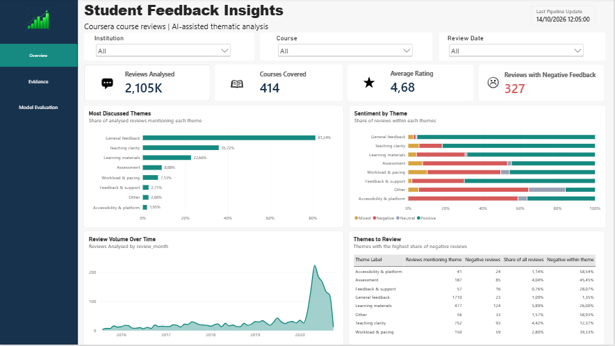
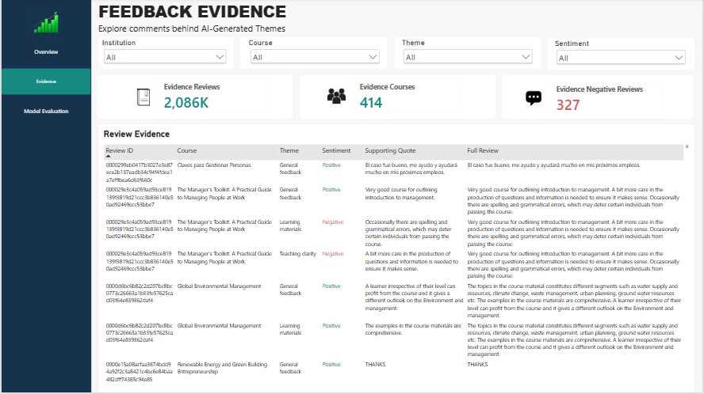
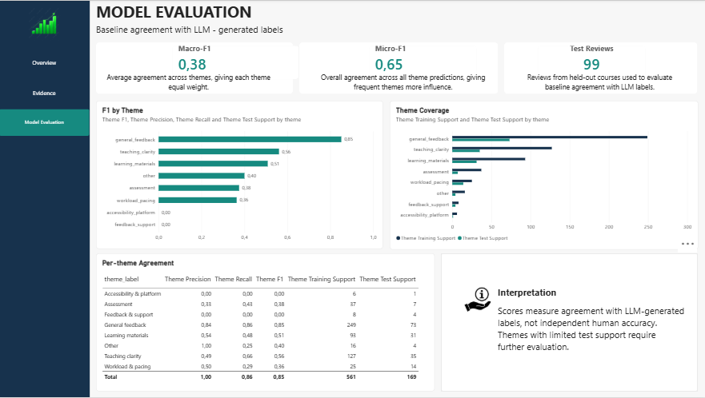
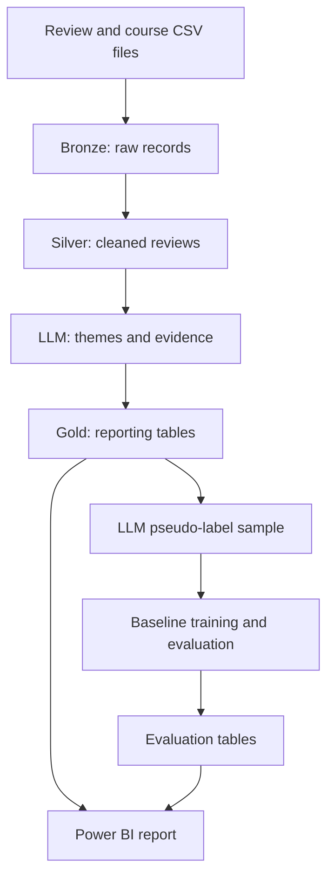

# Student Feedback Intelligence

**An educational feedback analytics prototype using Databricks, LLM thematic analysis, and Power BI.**

This project turns course-review text and ratings into structured feedback themes, sentiment labels, and supporting quotations. It also trains a lightweight TF-IDF and Logistic Regression baseline to predict LLM-generated theme labels.

The aim is to help an analyst identify recurring feedback patterns and inspect the comments behind them.

## Project Status

- Implemented: Bronze, Silver, and Gold tables in Databricks.
- Implemented: multi-theme extraction using a Databricks-hosted LLM.
- Implemented: evidence-span checks and course metadata enrichment.
- Implemented: baseline training and evaluation against LLM pseudo-labels.
- Power BI report developed with Overview, Evidence, and Model Evaluation pages.
- Scheduled pipeline execution and Power BI Service refresh: configuration and end-to-end verification pending.
- Public dashboard embedding: not yet confirmed available.

## Business Questions

- Which teaching and learning themes appear in course feedback?
- What do learners describe positively or negatively within each theme?
- Which comments support an identified issue?
- How do review volumes and feedback patterns vary across courses and dates?
- How closely can a lightweight classifier reproduce the LLM's theme labels?

The report supports investigation. It does not establish that feedback patterns cause changes in teaching quality or learning outcomes.

## Dashboard Preview

Upload actual report screenshots to the paths below. These images are static previews.

### Overview

Review counts, courses covered, average ratings, theme frequency, sentiment composition, and historical review volume.



### Feedback Evidence

Course, theme, and sentiment filters let users inspect supporting quotations alongside full comments.



### Model Evaluation

Overall and per-theme agreement metrics, with training and test support counts.



## Technology Stack

| Component | Technology |
|---|---|
| Data platform | Databricks and Unity Catalog |
| Storage | Delta tables and Unity Catalog volumes |
| Processing | Python, PySpark, SQL, pandas |
| LLM inference | Databricks `ai_query` |
| LLM endpoint | `databricks-gpt-oss-120b` |
| Structured output | JSON Schema and Spark `from_json` |
| Baseline model | TF-IDF and One-vs-Rest Logistic Regression |
| Evaluation | scikit-learn |
| Reporting | Power BI and DAX |
| Source control | GitHub |

The LLM is used for inference. It is not fine-tuned in this project. The workflow currently uses fixed processing steps rather than an autonomous agent.

## Dataset

Source: [Course Reviews on Coursera — Kaggle](https://www.kaggle.com/imuhammad/course-reviews-on-coursera).

| File | Columns |
|---|---|
| `Coursera_courses.csv` | `name`, `institution`, `course_url`, `course_id` |
| `Coursera_reviews.csv` | `reviews`, `reviewers`, `date_reviews`, `rating`, `course_id` |

Reviews are joined to course metadata using `course_id`.

The source is a historical snapshot, not a live Coursera feed. Public course reviews differ from institutional surveys in sampling, response behaviour, and educational context. This project does not use UNSW myExperience or QILT data.

Download the dataset from its original source and review its usage terms before redistributing data. Raw reviewer identities are not needed in the reporting layer.

## Data Architecture



### Bronze

Raw CSV records are ingested into Delta tables. A deterministic hash identifies records, and a Delta `MERGE` inserts records not already present.

The hash uses source fields, including reviewer, date, rating, course ID, and review text. Exact duplicate records are deduplicated. An edited source review is treated as a new record because a stable source review ID is unavailable.

### Silver

Processing includes:

- trimming course IDs and normalising whitespace;
- parsing ratings and dates;
- basic email and URL redaction;
- separating accepted and rejected records;
- enriching reviews with course metadata.

Basic pattern redaction is not complete anonymisation. Missing or unparsed dates remain visible in quality checks and are excluded from time-based reporting.

### Gold

LLM output is parsed into a Spark struct, expanded to one row per predicted theme, and checked for allowed labels and supporting text.

An evidence check confirms that a quotation occurs in the cleaned review. It does not prove that the quotation semantically supports the label.

## Main Tables

| Table | Purpose |
|---|---|
| `workspace.feedback_bronze.reviews_raw` | Raw reviews and ingestion metadata |
| `workspace.feedback_bronze.courses` | Course metadata |
| `workspace.feedback_silver.reviews_quality` | Accepted and rejected records |
| `workspace.feedback_silver.reviews_clean` | Clean, enriched reviews |
| `workspace.feedback_gold.llm_results` | Saved LLM results by review and prompt version |
| `workspace.feedback_gold.theme_predictions` | Expanded predictions and evidence checks |
| `workspace.feedback_gold.review_overview` | One row per processed review |
| `workspace.feedback_gold.review_themes` | Accepted theme predictions |
| `workspace.feedback_gold.course_theme_monthly` | Monthly theme aggregates |
| `workspace.feedback_gold.pseudo_label_evaluation` | Overall baseline agreement metrics |
| `workspace.feedback_gold.pseudo_label_theme_metrics` | Per-theme metrics and support counts |

Temporary staging tables materialise responses before merging, avoiding repeated inference when results are inspected.

## Theme Framework

| Theme | Meaning |
|---|---|
| Teaching clarity | Clarity of explanations and teaching |
| Learning materials | Videos, readings, examples, and resources |
| Assessment | Assignments, exams, grading, and instructions |
| Workload and pacing | Workload, duration, and learning pace |
| Feedback and support | Help and feedback from instructors or peers |
| Accessibility and platform | Accessibility, subtitles, and platform issues |
| Other | Specific feedback outside the listed themes |
| General feedback | Overall feedback without a specific aspect |

One review can contain multiple themes. Each theme receives a positive, negative, neutral, or mixed sentiment and a supporting quotation.

The annotation export also flags Han characters for language review. This is script detection, not definitive Chinese-language identification; Japanese text can contain Han characters too.

## Baseline Evaluation

The baseline combines:

1. TF-IDF features using unigrams and bigrams.
2. One-vs-Rest Logistic Regression with balanced class weights.
3. A course-grouped train/test split using `GroupShuffleSplit`.

Courses are kept entirely in either training or test to assess transfer to unseen courses. The fraction of test reviews can differ from the fraction of test courses.

### Recorded Results

Results below refer to the reported experiment with **99 test reviews**. Update them when a new experiment is recorded.

| Metric | Value |
|---|---:|
| Macro-F1 | 0.3824 |
| Micro-F1 | 0.6469 |
| Test reviews | 99 |

| Theme | Precision | Recall | F1 | Test support |
|---|---:|---:|---:|---:|
| Teaching clarity | 0.49 | 0.66 | 0.56 | 35 |
| Learning materials | 0.54 | 0.48 | 0.51 | 31 |
| Assessment | 0.33 | 0.43 | 0.38 | 7 |
| Workload and pacing | 0.50 | 0.29 | 0.36 | 14 |
| Feedback and support | 0.00 | 0.00 | 0.00 | 4 |
| Accessibility and platform | 0.00 | 0.00 | 0.00 | 1 |
| Other | 1.00 | 0.25 | 0.40 | 4 |
| General feedback | 0.84 | 0.86 | 0.85 | 73 |

The 169 positive labels in the test set are not 169 separate reviews: a review can have several labels.

### Interpretation

General feedback shows the strongest agreement. Several specific themes have low recall or limited support. For example, precision of 1.00 for Other is based on very few examples and should not be interpreted as robust performance.

**Reference labels are generated by the LLM. These metrics measure baseline agreement with those labels, not accuracy against independently annotated human ground truth.** They also do not evaluate the LLM's sentiment or quotation quality.

Rows without accepted suggested themes are excluded from this experiment, which further limits its scope.

## Power BI Model

The core relationship is:

`review_overview[review_id]` **1 → many** `review_themes[review_id]`

Filtering is single-direction from overview to themes. Evaluation tables are separate and do not recompute model scores when report users filter courses.

Key measures use:

- distinct review IDs for review counts;
- overview rows for average rating;
- distinct theme-review IDs for theme frequency;
- explicit denominators for negative shares.

Theme shares need not sum to 100% because reviews can mention multiple themes. Historical review dates and model-processing timestamps describe different events.

## Repository Structure

```text
README.md
notebooks/
    00_setup.py
    01_ingest_bronze.py
    02_clean_silver.py
    03_extract_themes.py
    04_build_gold.py
    05_prepare_annotations.py
    06_evaluate_models.py
images/
    overview.png
    evidence.png
    model.png
```

## Reproducing the Project

### Prerequisites

- Databricks workspace with Unity Catalog, suitable compute, and access to the chosen LLM endpoint.
- Permission to create schemas, volumes, and tables.
- The source CSV files.
- Power BI Desktop for reporting.
- `pandas` and `scikit-learn` for the baseline experiment.

Endpoint availability and compute quotas depend on the workspace. No public dashboard link is required to reproduce the data-processing steps.

### Run Order

| Notebook | Purpose |
|---|---|
| [00_setup](notebooks/00_setup.py) | Create schemas and the volume |
| [01_ingest_bronze](notebooks/01_ingest_bronze.py) | Ingest reviews and course metadata |
| [02_clean_silver](notebooks/02_clean_silver.py) | Clean, validate, and enrich reviews |
| [03_extract_themes](notebooks/03_extract_themes.py) | Extract themes, sentiment, and evidence |
| [04_build_gold](notebooks/04_build_gold.py) | Build reporting tables |
| [05_prepare_annotations](notebooks/05_prepare_annotations.py) | Export annotation samples and model suggestions |
| [06_evaluate_models](notebooks/06_evaluate_models.py) | Train and evaluate the baseline |

1. Import the notebook sources into Databricks.
2. Run `00_setup`.
3. Upload the CSV files to `/Volumes/workspace/feedback_bronze/feedback_files/`.
4. Run notebooks 01 and 02; inspect date parsing and quality summaries.
5. Configure the endpoint, batch size, and prompt version in notebook 03.
6. Start with a small batch and inspect the saved predictions.
7. Run notebook 04 using the same prompt version.
8. Run notebook 05 to create the sample and `annotations_suggested.csv`.
9. Run notebook 06 in pseudo-label mode, then save per-theme metrics.
10. Connect Power BI to the SQL warehouse and load the Gold tables.

The exported notebooks are Databricks sources, not standalone local Python scripts. Staging-table use assumes runs do not overlap.

## Automation Design

The proposed job runs notebooks **01 → 02 → 03 → 04**, with each task depending on successful completion of the previous task and maximum concurrent runs set to one.

The LLM step processes only reviews without results for the selected prompt version. Batch size limits records per run, not total accumulated results. Changing the model or prompt requires a new version identifier.

Current Bronze ingestion is incremental; Silver and reporting Gold tables are rebuilt. A daily schedule can process a historical backlog or newly supplied files, but it does not create a live source feed.

For Power BI Import mode, the semantic model must refresh after Gold updates. Independent schedules are time-based and do not guarantee that Databricks succeeded first. Success-triggered refresh is a future improvement.

Notebooks 05 and 06 are experiment workflows and should not run automatically as part of the reporting pipeline.

## Limitations and Next Steps

- Create an independently human-labelled evaluation set.
- Evaluate sentiment and evidence quality separately from theme detection.
- Increase coverage of rare themes and inspect multilingual performance.
- Persist a fixed test split for comparable experiments.
- Prevent identical review text from crossing evaluation splits.
- Compare transformer embeddings with the TF-IDF baseline.
- Verify scheduled jobs, Service credentials, and Power BI refresh end to end.
- Document inference latency, failures, and usage.
- Add a new-data source or clearly documented staged-file arrival demo.

## Author

**Agnes Jeni Makay**

- [LinkedIn](https://www.linkedin.com/in/agnes-makay)
- [GitHub](https://github.com/nesaugust)

